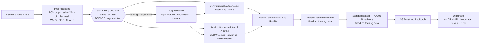

# Hybrid Autoencoder + Handcrafted Features + XGBoost for Five-Class Diabetic Retinopathy Grading

Reproducibility code for the manuscript **"A Hybrid Autoencoder-Based Feature Learning and XGBoost Framework for Early Detection and Classification of Diabetic Retinopathy Using Retinal Fundus Images"** (submitted to *Scientific Reports*).

The repository implements the complete framework, the leakage-controlled data protocol and every validation experiment requested during peer review. It does this with one configuration file and one command per experiment. Every number in the manuscript is generated by these scripts and gathered automatically into `outputs/RESULTS_SUMMARY.md`.

---

## 1. Proposed framework

The proposed model consists of the following components and no others. XGBoost is the **only** classifier of the proposed model. The other classifiers and CNNs in this repository are comparison methods.



**Algorithm 1 (as implemented in `train_hybrid.py`)**

1. Read the official labels, preprocess every original image and build the split groups: patient level for Kaggle/EyePACS, image level for APTOS, with near-duplicate photographs merged (`data_preparation.py`).
2. Partition the **original** images into training (70 %), validation (10 %) and test (20 %) sets with `StratifiedGroupKFold`, seed 42.
3. Generate augmented copies of **training** images only and run a leakage audit.
4. Train the autoencoder on training images, with early stopping on validation images.
5. Extract `z` (AE latent, 256-D) and `h` (handcrafted, 73-D) and concatenate them.
6. Select the Pearson threshold τ and the XGBoost hyperparameters by **validation** macro-F1.
7. Fit imputation → Pearson filter → standardisation → PCA → XGBoost on the **training** partition.
8. Evaluate once on the untouched test partition and record the metrics, confidence intervals, confusion matrix and timings.

## 2. Repository contents

| File | Purpose |
| --- | --- |
| `config.yaml` | Every hyperparameter of every stage, including seeds, split ratios, AE architecture, GLCM settings, Pearson grid, PCA, XGBoost, CV, baselines and the external dataset |
| `common.py` | Configuration loading, seeding, environment/hardware capture, I/O helpers |
| `preprocessing.py` | Fundus preprocessing, perceptual/difference hashing, training-only augmentation |
| `data_preparation.py` | Label validation, patient/duplicate grouping, stratified group split, dataset statistics, leakage audit |
| `autoencoder.py` | Convolutional AE (architecture, MSE + SSIM loss, Adam, regularisation), encoder, AE-ED |
| `handcrafted_features.py` | GLCM/Haralick texture, intensity statistics, lesion-area fractions, Hu moment invariants |
| `feature_pipeline.py` | Pearson selector, PCA, XGBoost and comparison classifiers, training-only fitting, validation tuning, feature banks |
| `metrics.py` | Overall, class-wise and clinical metrics, bootstrap CIs, McNemar, Friedman, Wilcoxon–Holm, Nadeau–Bengio, figures |
| `train_hybrid.py` | Proposed framework: training and held-out evaluation |
| `ablation.py` | Component ablation (A1–A7) |
| `classifier_comparison.py` | Seven classifiers on identical features, plus processing time with explicit units |
| `repeated_cv.py` | 5-fold × 3-repeat stratified group cross-validation, mean ± SD, 95 % CI, significance tests |
| `baselines_cnn.py` | ResNet50, DenseNet121, EfficientNetB0 and MobileNetV2 trained on the identical partitions |
| `cross_dataset.py` | APTOS → Kaggle, Kaggle → APTOS and an optional external dataset (IDRiD / Messidor-2) |
| `generate_report.py` | Builds `outputs/RESULTS_SUMMARY.md` with manuscript-ready tables |
| `smoke_test.py` | Download-free end-to-end test on synthetic fundus-like images |
| `run_all.sh` | Runs all experiments in order |

## 3. Installation

```bash
python -m venv .venv && source .venv/bin/activate      # Windows: .venv\Scripts\activate
pip install -r requirements.txt
python smoke_test.py                                     # verifies the full pipeline in ~5-15 min on CPU
```

A GPU is recommended for the autoencoder and the CNN baselines. The remaining stages run on a CPU.

## 4. Datasets

The images are not redistributed. Download them from the original sources and place them as follows, or edit the paths in `config.yaml`:

```
data/aptos2019/train.csv                 data/aptos2019/train_images/<id_code>.png
data/kaggle_eyepacs/trainLabels.csv      data/kaggle_eyepacs/train/<patient>_<left|right>.jpeg
```

| Dataset | Source | Images (official labelled set) | Grades 0/1/2/3/4 |
| --- | --- | --- | --- |
| APTOS 2019 Blindness Detection | https://www.kaggle.com/competitions/aptos2019-blindness-detection | 3,662 | 1805 / 370 / 999 / 193 / 295 |
| Kaggle Diabetic Retinopathy Detection (EyePACS) | https://www.kaggle.com/competitions/diabetic-retinopathy-detection | 35,126 | 25810 / 2443 / 5292 / 873 / 708 |
| IDRiD (optional external test) | https://idrid.grand-challenge.org/ | 516 | ICDR grades 0–4 |
| Messidor-2 (optional external test) | https://www.adcis.net/en/third-party/messidor2/ | 1,748 | requires ICDR-graded label file |

`data_preparation.py` compares the usable class counts with the official counts above. It logs any difference (missing or unreadable files, for example) in `dataset_report.json`, so the dataset tables in the manuscript always match the files actually used.

Both public datasets contain de-identified retinal fundus photographs released by their providers for research use. This work is a secondary analysis and involves no contact with patients.

## 5. Running the experiments

```bash
bash run_all.sh                 # everything, both datasets
# or step by step
python data_preparation.py --dataset all
python train_hybrid.py --dataset all
python ablation.py --dataset all
python classifier_comparison.py --dataset all
python repeated_cv.py --dataset aptos
python baselines_cnn.py --dataset all
python cross_dataset.py
python generate_report.py
```

Any setting can be overridden without editing the file, for example:
`python train_hybrid.py --dataset aptos --set xgboost.max_depth=8 --set pca.variance_retained=0.99`

## 6. Leakage-control protocol

| Risk | Control implemented | Verified by |
| --- | --- | --- |
| Augmented copies of one image in both training and test sets | Split on originals first; augmentation plan built from training identifiers only; each synthetic image keeps `parent_id` | `leakage_audit()` aborts the run on any violation; `training_matrix()` re-checks every parent |
| Both eyes of one patient in different partitions (EyePACS) | Patient identifier parsed from file name; patient = split group | `patients_spanning_multiple_splits = 0` |
| Duplicate photographs under different file names (APTOS) | pHash **and** dHash of the retinal core; pairs within Hamming distance 6 share a group | `near_duplicate_pairs.csv`, `groups_spanning_multiple_splits = 0` |
| Feature selection or PCA fitted on test data | Pearson filter, scaler and PCA are steps of one scikit-learn `Pipeline`, fitted on training data only | `fit_model()` |
| Hyperparameters tuned on the test set | τ and XGBoost grid chosen by validation macro-F1; the test set is read once | `validation_tuning.csv` |
| AE trained on evaluation images | AE fitted on training images only; retrained inside every CV fold | `train_autoencoder()`, `repeated_cv.py` |

## 7. Outputs (per dataset under `outputs/<dataset>/`)

* `data/`: `split_manifest.csv` (image → split, group, hashes), `dataset_statistics.csv` (original / augmented / train / val / test per class with verified totals), `augmentation_plan.csv`, `near_duplicate_pairs.csv`, `dataset_report.json`
* `autoencoder/`: trained encoder and AE, architecture summary, loss history, reconstruction examples
* `proposed/`: `test_metrics.json` (overall, class-wise and clinical metrics, bootstrap CIs, hyperparameters, timing, hardware), confusion matrix (CSV + 300 dpi PNG), ROC curves, per-image predictions, Pearson selection table, PCA explained variance, fitted pipeline
* `ablation/`, `classifier_comparison/`, `repeated_cv/`, `baselines/`: result tables, figures and statistical tests
* `outputs/cross_dataset/`: transfer results, generalisation gap and AE-ED distribution-shift tests
* `outputs/RESULTS_SUMMARY.md`: all tables above in Markdown, plus the full configuration

## 8. Evaluation measures

Accuracy, balanced accuracy, macro precision, macro sensitivity, macro specificity, macro-F1, weighted F1, Cohen's κ, quadratic weighted κ, MCC and macro one-vs-rest ROC-AUC are reported, each with a stratified bootstrap 95 % CI (2,000 resamples). The class-wise one-vs-rest outputs are precision, sensitivity, specificity, NPV and F1. The clinical outputs are:

* referable-DR (grade ≥ 2) sensitivity and specificity
* under-grading rate
* share of errors between adjacent grades
* proportion of Severe/PDR images predicted as No DR or Mild

## 9. Implementation details (defaults in `config.yaml`)

| Component | Setting |
| --- | --- |
| Preprocessing | FOV crop (threshold 7), 224 × 224, circular mask, Wiener 3 × 3, CLAHE on L (clip 2.0, 8 × 8 tiles) |
| Augmentation (training only) | horizontal flip p = 0.5, rotation ±25°, brightness ×[0.85, 1.15], contrast ×[0.85, 1.15]; each class raised towards the largest class, ≤ 8 copies per image |
| Autoencoder | input 128 × 128 × 3; encoder 4 × [Conv 3 × 3 s1 → BN → LeakyReLU(0.2) → Conv 3 × 3 s2 → BN → LeakyReLU] with 32/64/128/256 filters; Dense latent 256; mirrored Conv2DTranspose decoder, sigmoid output; loss MSE + 0.2·(1 − SSIM); Adam 1e-3, batch 64, ≤ 60 epochs, early stopping 8, ReduceLROnPlateau ×0.5; L2 1e-5; latent dropout 0.2 |
| Handcrafted (73) | GLCM (64 levels, d = 1, 2, 4; 0/45/90/135°): contrast, dissimilarity, homogeneity, energy, correlation, ASM, mean and range over angles (36); green-channel statistics and lesion-area fractions (16); Hu moments of intensity, bright-lesion and dark-lesion maps (21) |
| Pearson selection | relevance-ordered redundancy filter, τ ∈ {0.80, 0.85, 0.90, 0.95, 0.98} chosen on validation macro-F1 |
| PCA | after z-score standardisation, components explaining 95 % of training variance |
| XGBoost | multi:softprob, 800 trees, η 0.05, depth 6, min child weight 1, subsample 0.8, colsample 0.8, λ 1, α 0, hist, early stopping 50 on validation, balanced sample weights; depth {4, 6, 8} × η {0.03, 0.05, 0.1} × min child weight {1, 3} searched on validation |
| Comparison classifiers | LR (C = 1, balanced), DT (min leaf 2, balanced), KNN (k = 7, distance), Gaussian NB, RF (500 trees, balanced subsample), SVM (RBF, C = 10, γ = scale, balanced) |
| CNN baselines | ImageNet weights, 224 × 224, GAP → Dropout 0.3 → Dense 5; 5 head epochs (Adam 1e-3) then top 30 % unfrozen (Adam 1e-4, ≤ 25 epochs, early stopping 6), batch 32 |

## 10. Reviewer comments addressed by this code

| Comment | Implementation |
| --- | --- |
| Editor: Code Availability | This repository; the release used in the paper is archived as a versioned snapshot |
| R1-1, R1-11, R2-4 to R2-7: single defined model and classifier | Section 1 diagram and Algorithm 1; `train_hybrid.py` contains only AE + handcrafted + Pearson + PCA + XGBoost |
| R1-3: augmentation before split | `data_preparation.py` splits originals first; leakage audit |
| R1-4, R1-5: inconsistent counts and split ratios | `dataset_statistics.csv` with arithmetically asserted totals; exact counts per partition |
| R1-6: image vs patient level, seed, stratification, CV | Patient-level (EyePACS) / image-level with duplicate grouping (APTOS); seed 42; `StratifiedGroupKFold`; `repeated_cv.py` |
| R1-7: metrics beyond accuracy | `metrics.py`: class-wise precision, sensitivity, specificity, F1, macro-F1, balanced accuracy, κ, QWK and confusion matrices for both datasets |
| R1-8: ablation | `ablation.py` (A1–A7) |
| R1-9: same-protocol baselines | `baselines_cnn.py` (ResNet50, DenseNet121, EfficientNetB0, MobileNetV2) |
| R1-10: cross-dataset generalisation | `cross_dataset.py` (APTOS ↔ Kaggle; optional IDRiD / Messidor-2) |
| R1-12: reproducibility details | `config.yaml`, Section 9, `autoencoder_architecture.txt` |
| R1-13: Pearson threshold and PCA on training data | `PearsonCorrelationSelector` and PCA inside the training-fitted pipeline; τ chosen on validation |
| R1-14, R2-3: processing time | `classifier_comparison.py`: training time in seconds, inference in ms/image, hardware and library versions recorded |
| R1-15: statistical reliability | Repeated CV mean ± SD and t-based 95 % CI; bootstrap CIs; McNemar, Friedman, Wilcoxon–Holm, Nadeau–Bengio tests |
| R1-18: clinical interpretation | Referable-DR sensitivity, under-grading and critical false-negative rates in `clinical_metrics()` |
| R2-8, R2-9: inconsistent reported accuracy | `generate_report.py` produces one set of values used throughout the manuscript |

## 11. Code availability

The source code that implements the preprocessing, autoencoder feature learning, handcrafted feature extraction, training-only Pearson feature selection and PCA, XGBoost classification and all validation experiments is publicly available in this repository. The exact version used to generate the results reported in the article is archived as a tagged release.

## 12. Citation

Citation metadata is provided in `CITATION.cff`.
